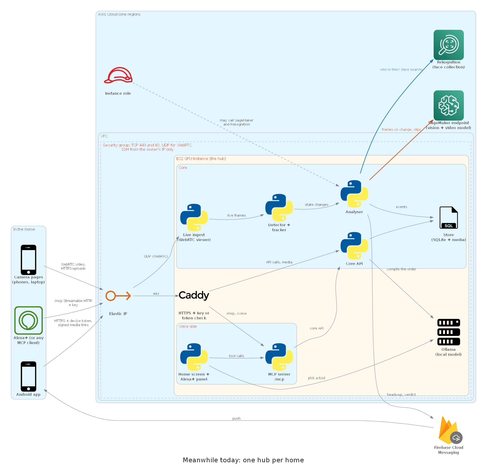
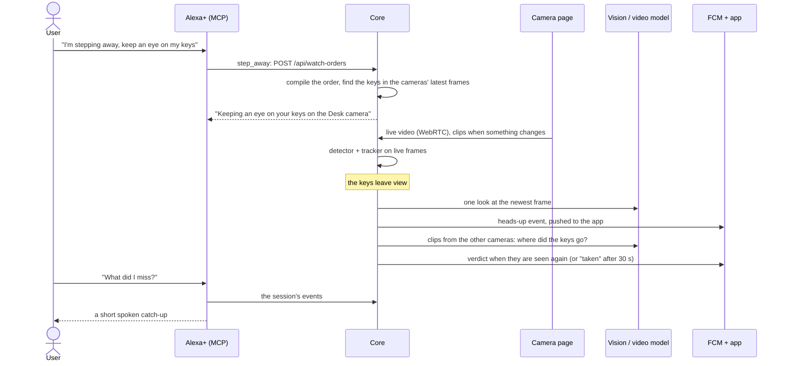
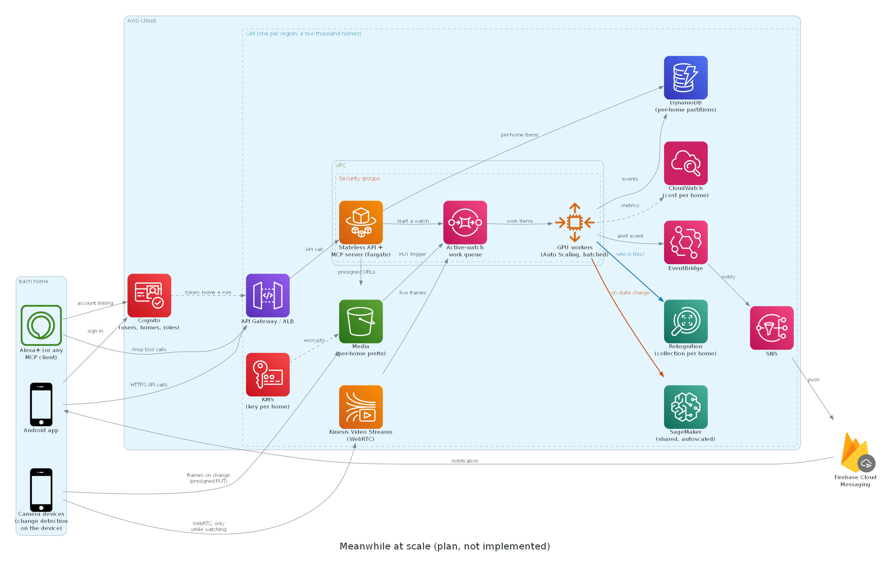

# Meanwhile architecture

## Today: one hub per home
Each home runs its own hub: one GPU box (or a laptop) with everything on it, plus the services it calls.

One watch, from stepping away to the catch-up:

**Where data lives**

| Data | Where |
|---|---|
| Cameras, people, sessions, events, paired devices (tokens as hashes) | the hub's SQLite database |
| Frames, clips, thumbnails of the last few minutes, people's photos | the hub's media folder, served at `/media` |
| Face vectors of registered and unnamed people | the home's own Amazon Rekognition collection |
| The app's device token and the default hub | the phone |
| Push delivery | Firebase Cloud Messaging (the event's summary and ids) |

**Trust boundary:** every request passes the hub's gate with the shared key or a paired device's token (paired by a
one-time QR code). Each setup is independent: its own key, database, media, face collection and Firebase project.

## Scaling plan (not implemented)
A hosted, multi-tenant edition for many homes would look like this:

- **Principle:** cost follows active watching and events, not wall-clock time. Most of the day nothing is watched,
  and most watched frames show no change.
- **Edge first:** change detection runs on the camera device (the camera page already does this), so the cloud gets
  frames only when something changes; live view stays peer to peer.
- **Shared GPUs:** one queue of active-watch work feeds a GPU worker pool that batches frames from many homes and
  scales on queue depth; the vision and video models sit on shared, autoscaled endpoints and are still called only
  on state changes.
- **Per-home isolation:** every request carries the home from its token, and the same boundary is enforced in IAM
  (S3 prefixes, DynamoDB keys), with per-home encryption keys and one face collection per home.
- **Cells:** independent stacks of a few thousand homes per region limit the blast radius and keep data in the
  user's region.
- **What stays:** the product logic (watch orders, the tracker's rules, face naming, look and look-back, the
  catch-up) already works on frames, events and a store; scaling changes where it runs, not what it does. The
  self-hosted edition stays as the open-source option.
- **Estimated cost:** about $5 per home per month for 2 cameras and 2 hours of watching a day (an estimate to be
  measured, not a result), against a dedicated GPU box and endpoint per home today.
- **Phases:**
  1. Hosted MVP: Cognito users and homes, the API on Fargate, DynamoDB + S3, one GPU pool, multi-tenant MCP.
  2. Edge offload: change detection on the device, Kinesis Video Streams for live view and on-demand pulls.
  3. Efficiency: batching, autoscaling on queue depth, a small-to-large model cascade, spot capacity.
  4. Scale-out and trust: cells per region, per-home keys, retention and deletion guarantees, audit logs, quotas.

The two images are drawn by `architecture/today.py` and `architecture/scaled.py`: with Graphviz on PATH,
`pip install -r architecture/requirements.txt`, then run both scripts from the repo root.
